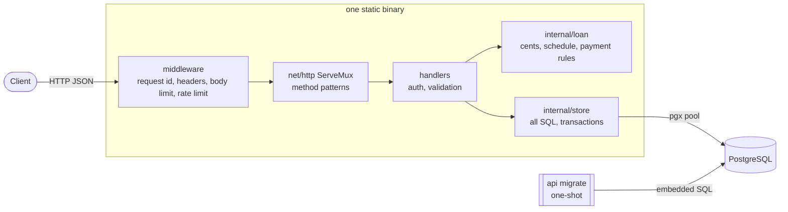

# go-postgres-boilerplate

One of three implementations of the same loan API: [Express + MongoDB](https://github.com/the-vishal-kumar/nodejs-typescript-rest-boilerplate), [Fastify + PostgreSQL](https://github.com/the-vishal-kumar/fastify-postgres-boilerplate) and **Go + PostgreSQL** (this repo). They share one contract and one conformance suite, and are [measured side by side](https://github.com/the-vishal-kumar/nodejs-typescript-rest-boilerplate/blob/main/docs/comparison.md).

[](https://github.com/the-vishal-kumar/go-postgres-boilerplate/actions/workflows/ci.yml?query=branch%3Amain)


[](./LICENSE)

## Problem

Customers request a loan with an amount and a term in weeks. An admin approves it. The customer repays it in weekly instalments, in order, and the loan becomes `PAID` with the last one.

The rules are small but real:

- **Exact money.** Amounts have at most two decimals and are stored in integer cents. A schedule splits the amount into equal instalments with the remainder on the last one, so it always adds up (10000 over 3 is 3333.33, 3333.33, 3333.34).
- **Approval rules.** Only an admin approves, never their own loan, and never twice.
- **Ordered repayments.** A payment must cover the next instalment and may not exceed the balance; any surplus pays the following instalments.
- **Concurrency.** Two payments racing on one loan must never apply money twice or lose it.

The full behaviour is the [OpenAPI contract](./internal/docs/openapi.json) plus the [conformance suite](https://github.com/the-vishal-kumar/nodejs-typescript-rest-boilerplate/tree/main/conformance), which this repo passes in CI.

## Design



- **Standard library first.** Routing is `net/http.ServeMux` with method patterns, logging is `log/slog` (JSON), HS256 JWTs are signed and verified with `crypto/hmac`, UUIDs come from `crypto/rand`. Three direct dependencies: `pgx` (PostgreSQL), `golang.org/x/crypto` (scrypt) and `swaggo/files` (the embedded Swagger UI assets).
- **Domain logic is pure.** [`internal/loan`](./internal/loan) parses money into cents exactly (`math/big`), splits schedules and applies payments without touching the database, so the rules are unit tested in isolation.
- **Validation by hand**, with the contract's messages (`"amount" is required`). Bodies are decoded with `UseNumber`, so amounts never pass through a float before the cent check.
- **PostgreSQL with plain SQL** through `pgx`. [`internal/store`](./internal/store) holds every query. Money is `bigint` cents, statuses are enum types, and email uniqueness is a unique index on `lower(email)`.
- **Migrations** are SQL files in [`migrations/`](./migrations), embedded in the binary and applied by `api migrate` in a one-shot container before the API starts. The migrator records versions in `schema_migrations` and holds an advisory lock, so replicas starting together cannot race.
- **Repayment concurrency:** one transaction that locks the loan row (`SELECT ... FOR UPDATE`), reads the pending instalments, applies the payment and commits. A second payment waits for the lock and then sees the first one's result, so both apply in sequence. Approval uses a conditional `UPDATE ... WHERE status = 'PENDING'`.
- **Auth:** the database stores only a SHA-256 of each token, so sign-off and password reset can revoke sessions. Passwords use scrypt with the same parameters and format as the Node implementations, so a user table could move between them.
- **Operations:** `/health/live` never touches the database, `/health/ready` pings it and fails while shutting down. SIGTERM fails readiness, drains in-flight requests through `http.Server.Shutdown`, closes the pool and exits 0. Configuration comes only from the environment and is validated at start-up, with every problem reported at once.
- **Image:** a static binary on `distroless/static` as a non-root user. There is no shell or curl, so the binary checks itself (`api healthcheck`) for the Docker health check.

## Trade-offs of this stack

- **Small to ship, not lean under load.** One static binary in the smallest image of the three (37.5 MB) with the lowest memory at rest (12.6 MiB) and the highest throughput (182.5 requests/s). Under load it has the highest peak memory (338.6 MiB, from hashing every concurrent sign-in at once), and its cold start (958 ms) is slower than Express (814 ms). The [comparison](https://github.com/the-vishal-kumar/nodejs-typescript-rest-boilerplate/blob/main/docs/comparison.md) has the measured numbers.
- **More code for the same behaviour.** Without a validation library or framework, request decoding, validation messages and middleware are written out by hand. That code is explicit and easy to step through, but it is more lines than the Fastify version.
- **Compile-time safety stops at the SQL boundary.** Go's types cover the handlers and domain, but queries are strings checked only by the integration tests. A generator such as sqlc would close that gap at the cost of a build step.
- **Relational guarantees for free.** As in the Fastify version, unique emails, foreign keys, check constraints and the row lock live in the database, where the MongoDB version needs a lease document.
- **Single-process rate limits.** Limits are kept in memory, per process. Several replicas need a shared store such as Redis.

## Quick start (Docker only)

```bash
git clone https://github.com/the-vishal-kumar/go-postgres-boilerplate.git
cd go-postgres-boilerplate
make up        # API and PostgreSQL on http://localhost:3000, docs at /docs
make down
```

Every target runs in containers; the host needs only Docker and make.

| Target | What it does |
|---|---|
| `make lint` | `gofmt` check and `go vet` |
| `make vet` | `go vet` (the compiler is the type checker) |
| `make build` | Static binary in `.cache/api` |
| `make test` | Unit and integration tests, race detector on, against a throwaway PostgreSQL |
| `make conformance` | Fresh stack plus the shared conformance suite |
| `make image` / `make scan` | Production image; Trivy scan for fixable HIGH/CRITICAL CVEs |
| `make bench` | The shared k6 load test (see below) |

Configuration lives in [`.env.sample`](./.env.sample); `make up` copies it to `.env` on first run.

## Conformance suite and benchmark

The conformance suite and the load test live in the [reference implementation](https://github.com/the-vishal-kumar/nodejs-typescript-rest-boilerplate/tree/main/conformance), released by the `conformance-v2` tag. `make suite` fetches that tag into the git-ignored `.cache/` with a git container, so there is one copy and no vendored drift.

- `make conformance` starts a fresh stack (with `ADMIN_SIGNUP_ENABLED=true` and `TRUST_PROXY=1`) and runs the suite with `node --test` in a Node container. It also checks that `/docs/openapi.json` is the contract with only the title and description changed.
- `make bench` runs the k6 mix (sign-in, loan request, list, get, admin approval, repayment) under the CPU and memory limits in [`compose.bench.yaml`](./compose.bench.yaml), which all three implementations share. Results go to `.cache/bench/result.json`.

Cases that need the database or the process are covered by this repo's own tests in [`internal/httpapi/integration_test.go`](./internal/httpapi/integration_test.go): tokens stored only as hashes, expired sessions, 500 without internals when the database fails, readiness while shutting down, admin sign-up switched off, the recorded approver, racing payments and idempotent migrations.

## CI

[`.github/workflows/ci.yml`](./.github/workflows/ci.yml), actions pinned by commit SHA:

1. `gofmt`, `go vet`, build, and `go test -race` with integration tests against a PostgreSQL service.
1. Image build, compose up (migrations first), the conformance suite, a smoke test, a check that SIGTERM exits 0, and a Trivy scan.

## License

[MIT](./LICENSE), Vishal Kumar.
